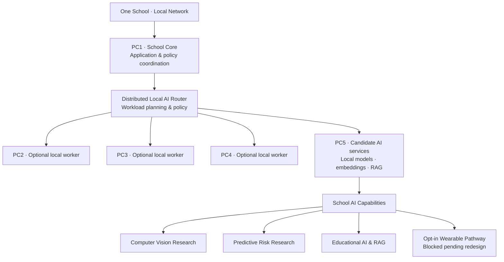

# SchoolSmartEYE AI
### A Local-First Intelligent-School Ecosystem

**SchoolSmartEYE AI** is being developed as a school-focused platform connecting educational knowledge assistance, school workflows, and carefully governed safety-oriented research through a distributed local AI architecture.

> **The core idea:** make practical AI capabilities available within a school's local environment, coordinating suitable workloads across ordinary computers where testing proves they are appropriate—rather than assuming every school needs an expensive dedicated AI server or permanent cloud connectivity.

## The architecture vision

*This is an illustrative target architecture, not a claim that a five-device production deployment or end-to-end distributed inference has been validated.*

## Main capability areas

| Area | Purpose | Current maturity |
|---|---|---|
| Distributed Local AI Router | Coordinate eligible local workloads across school computers | Experimental foundation; not end-to-end distributed execution |
| PC1–PC5 topology | Separate school core, optional workers, and local AI services | Target architecture; five-device deployment not validated |
| Educational AI & RAG | Answer questions grounded in approved school documents | Candidate / experimental; governance and operational acceptance remain |
| Computer Vision | Explore visual signals for narrowly scoped school use cases | Experimental; current preserved engine measures luminance changes |
| Temporal / Fall Detection | Research time-based safety signals | Experimental research; not a validated safety alarm |
| Predictive Risk Intelligence | Explore cautious, human-reviewed risk indicators | Research direction; no proven prediction accuracy |
| Smart Wearable | Potential opt-in sensor pathway | Blocked pending security, schema, consent, and governance redesign |

## Why local-first?

A local-first design may help schools:
- keep approved workloads and data within the school environment;
- continue selected workflows during internet interruptions;
- make measured use of existing computers where hardware benchmarks support it;
- scale gradually from one school to additional sites.

These are design goals, not measured outcomes. No cost savings, speed improvements, or reliability figures are claimed without pilot evidence.

## Current development stage

The V3 engineering work is consolidating foundations and prototypes. It is **not yet a complete production-ready school application**. Authenticated PC1-to-PC5 execution, validated multi-device deployment, complete application acceptance, production LAN deployment, and reproducible performance benchmarks remain work to complete.

## Investor review materials

- [Investor overview](docs/INVESTOR_OVERVIEW.md)
- [Live-demo preparation guide](docs/DEMO_GUIDE.md)
- [Capability readiness matrix](docs/READINESS_MATRIX.md)
- [Privacy and safety principles](docs/PRIVACY_AND_SAFETY.md)
- [Development roadmap](docs/ROADMAP.md)

## Responsible development

School environments require strong privacy and safeguarding. Demonstrations should use synthetic, non-identifying data. AI outputs that may affect student safety or wellbeing must remain advisory and subject to qualified human review. No facial recognition, emotion recognition, attention scoring, or automated disciplinary decisions are presented as acceptable product goals.

## Next step

The next milestone is a controlled one-school prototype: complete the local security and execution path, demonstrate an approved-document knowledge workflow, measure hardware performance, and validate usability and safeguards before expanding capabilities.

**This repository is a public product and investor overview. It intentionally does not contain the private engineering source code, secrets, student data, or internal security configuration.**
